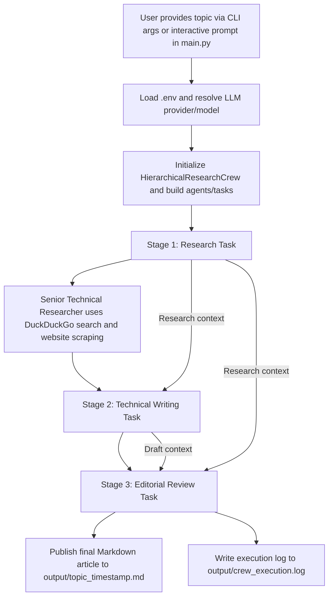

# 🚀 Autonomous Multi-Agent Technical Research & Writing Crew

[](https://github.com/joaomdmoura/crewAI)
[](https://www.python.org/)
[](https://github.com/BerriAI/litellm)
[](LICENSE)

An enterprise-ready, modular multi-agent workflow powered by **[CrewAI](https://github.com/joaomdmoura/crewAI)**. This automation orchestrates specialized AI agents—a **Senior Researcher**, **Technical Writer**, and **Editorial Reviewer**—to autonomously gather empirical data from the live web, synthesize complex topics, and draft publication-grade technical markdown articles complete with citations and benchmarks.

---

## 📌 Table of Contents

- [Overview](#-overview)
- [System Architecture & Agent Workflow](#-system-architecture--agent-workflow)
- [Repository & File Structure](#-repository--file-structure)
- [Detailed File & Module Catalog](#-detailed-file--module-catalog)
- [Prerequisites](#-prerequisites)
- [Installation & Setup](#-installation--setup)
- [Environment Configuration](#-environment-configuration)
- [How to Run the Automation](#-how-to-run-the-automation)
- [Execution Outputs & Artifacts](#-execution-outputs--artifacts)
- [Key Engineering Highlights](#-key-engineering-highlights)
- [Troubleshooting & FAQs](#-troubleshooting--faqs)
- [License](#-license)

---

## 📖 Overview

Writing comprehensive, accurate, and deeply cited technical articles typically demands hours of browsing, synthesizing disparate sources, structuring documentation, and proofreading. 

This project completely automates this pipeline using **CrewAI** and **LiteLLM**, providing:

- 🔍 **Live, Real-Time Web Research**: Free web search powered by DuckDuckGo and deep web page scraping with no costly search API keys required.
- 👥 **Role-Specialized Autonomous Agents**: Separation of concerns between information discovery, analytical prose composition, and editorial critique.
- 🔗 **Deterministic Context Chaining**: Downstream agents directly receive the verified research dossier and drafts from preceding tasks, eliminating hallucinations and context drift.
- 🔄 **Multi-Provider LLM Flexibility**: Run seamlessly on fast cloud inference (**Groq** LLaMA 3.3), Google Cloud (**Gemini 1.5/2.5**), or locally on offline hardware (**Ollama** LLaMA 3.1).
- 🛡️ **Zero Delegation Leaks**: Structured as a clean sequential pipeline to prevent nested JSON leaks or agent infinite loops.

---

## 🏗️ System Architecture & Agent Workflow

The application runs as a **sequential three-stage pipeline** (not manager-led delegation), where each stage receives explicit context from earlier work:



In practice, this means:

1. `main.py` accepts the topic from command-line arguments (or prompts interactively), loads environment variables, and determines the configured LLM provider.
2. The crew is initialized with provider-specific LLM settings and three specialist agents.
3. **Stage 1 (Research):** the researcher collects evidence using DuckDuckGo search plus website scraping.
4. **Stage 2 (Drafting):** the writer receives the research task as explicit context and produces the technical draft.
5. **Stage 3 (Editing):** the editor receives both the research context and the draft context, verifies quality/factual consistency, and writes the final Markdown output.
6. Artifacts are persisted as a timestamped article in `output/` and a run trace in `output/crew_execution.log`.

### Agent Roles

| Agent | Core Responsibility | Equipped Tools | Context Inputs | Output Produced |
| :--- | :--- | :--- | :--- | :--- |
| **Senior Technical Researcher** | Gathers verified technical findings, benchmarks, and source links. | `free_web_search`, `scrape_tool` | Topic input from `main.py` kickoff | Research dossier for downstream stages |
| **Lead Technical Writer** | Converts research findings into a coherent technical article draft. | *None (Pure Synthesis)* | Research task output (`context=[research_task]`) | Structured draft article |
| **Executive Editorial Reviewer** | Verifies factual consistency, improves clarity, and finalizes publishable Markdown. | *None (Editorial Logic)* | Research + writing outputs (`context=[research_task, writing_task]`) | Final Markdown written to `output/{topic}_{timestamp}.md` |

---

## 📂 Repository & File Structure

```
crewai_research_crew/
│
├── config/
│   ├── agents.yaml             # Agent role definitions, goals, and backstories
│   └── tasks.yaml              # Task descriptions, criteria, and expected outputs
│
├── output/                     # Auto-created directory for generated artifacts
│   ├── .gitkeep / *.md         # Timestamped research articles (e.g. deep_learning_*.md)
│   └── crew_execution.log      # Complete chronological execution logs and tool calls
│
├── src/
│   ├── __init__.py             # Root source package initializer
│   ├── crew.py                 # Core orchestration class (HierarchicalResearchCrew)
│   │
│   ├── agents/
│   │   ├── __init__.py         # Package exports for ResearchCrewAgents
│   │   └── crew_agents.py      # LLM provider instantiation and agent factory
│   │
│   ├── tasks/
│   │   ├── __init__.py         # Package exports for ResearchCrewTasks
│   │   └── crew_tasks.py       # Task definitions and explicit context chaining
│   │
│   └── tools/
│       ├── __init__.py         # Package exports for search & scraping tools
│       └── search_tools.py     # Custom DuckDuckGo search tool & ScrapeWebsiteTool
│
├── .env.example                # Template for environment variables and LLM configurations
├── .gitignore                  # Git ignore rules for environments, outputs, and cache
├── main.py                     # CLI entrypoint with LiteLLM monkey-patches
├── README.md                   # Comprehensive project documentation
└── requirements.txt            # Python dependencies (CrewAI, DuckDuckGo, LiteLLM, etc.)
```

---

## 🔍 Detailed File & Module Catalog

### Root Files

| File | Purpose |
| :--- | :--- |
| `main.py` | The main execution entrypoint. Loads `.env`, applies a critical LiteLLM compatibility monkey-patch for Groq, captures CLI arguments or user prompts, and starts the Crew orchestrator. |
| `requirements.txt` | Defines pinned project dependencies including `crewai`, `crewai-tools`, `duckduckgo-search`, `litellm`, and `pyyaml`. |
| `.env.example` | Provides a pre-configured template for LLM selection (`groq`, `gemini`, or `ollama`) and API key placeholders. |
| `README.md` | Primary architectural and user documentation for this automation. |

### Configuration (`config/`)

| File | Purpose |
| :--- | :--- |
| `config/agents.yaml` | Decouples agent prompts from Python code. Configures roles, goals, and backstories for `senior_researcher`, `technical_writer`, `editorial_reviewer`, and `content_coordinator`. |
| `config/tasks.yaml` | Defines granular task specifications (`research_task`, `writing_task`, `editing_task`) and their expected outputs. |

### Core Source (`src/`)

| File | Purpose |
| :--- | :--- |
| `src/crew.py` | Implements `HierarchicalResearchCrew`. Coordinates agent assembly, task creation, safe filename formatting (`<topic>_<timestamp>.md`), and execution with `Process.sequential`. |
| `src/agents/crew_agents.py` | Contains `get_configured_llm()`, which switches between Gemini, Groq, and Ollama, and `ResearchCrewAgents`, which instantiates CrewAI `Agent` objects. |
| `src/tasks/crew_tasks.py` | Contains `ResearchCrewTasks`. Configures tasks and sets up explicit context dependencies (e.g. passing research output to the writer and editor). |
| `src/tools/search_tools.py` | Implements `@tool("Free Web Search")` using the DuckDuckGo `ddgs` library to retrieve real-time search snippets, and initializes `ScrapeWebsiteTool` for site extraction. |

### Output Directory (`output/`)

| Artifact | Purpose |
| :--- | :--- |
| `*.md` files | The generated publication-grade technical articles, dynamically named by topic and timestamp (e.g., `deep_learning_20261013_205721.md`). |
| `crew_execution.log` | Persistent log file capturing agent thinking steps, tool invocations, and output traces for debugging. |

---

## ⚙️ Prerequisites

- **Python**: Version **3.10** or higher (3.11 recommended).
- **Package Manager**: `pip` (or `poetry` / `uv`).
- **An LLM Provider** (choose at least one):
  - **Groq API Key** (Free, ultra-fast cloud inference: [console.groq.com](https://console.groq.com/))
  - **Google Gemini API Key** (Free tier available: [aistudio.google.com](https://aistudio.google.com/))
  - **Ollama** (100% local, offline inference: [ollama.ai](https://ollama.ai/))

---

## 🚀 Installation & Setup

### 1. Clone or Open the Workspace

Open your terminal in the project directory:

```bash
cd c:\Users\Lenovo\Desktop\Project\crewai_research_crew
```

### 2. Create and Activate a Virtual Environment

- **Windows (PowerShell)**:
  ```powershell
  python -m venv venv
  .\venv\Scripts\Activate.ps1
  ```

- **Windows (Command Prompt)**:
  ```cmd
  python -m venv venv
  venv\Scripts\activate.bat
  ```

- **Linux / macOS**:
  ```bash
  python3 -m venv venv
  source venv/bin/activate
  ```

### 3. Install Dependencies

Upgrade `pip` and install the required packages:

```bash
pip install --upgrade pip
pip install -r requirements.txt
```

---

## 🔑 Environment Configuration

Create your local `.env` file by copying `.env.example`:

```bash
# On Windows PowerShell
Copy-Item .env.example .env

# On Linux / macOS / Bash
cp .env.example .env
```

Open `.env` in your editor and configure your preferred provider.

### Option A: Groq (Recommended for Fast Cloud Inference)

```ini
LLM_PROVIDER=groq
GROQ_API_KEY=gsk_your_actual_groq_api_key_here
GROQ_MODEL=groq/llama-3.3-70b-versatile
```

### Option B: Google Gemini

```ini
LLM_PROVIDER=gemini
GEMINI_API_KEY=AIzaSy_your_gemini_api_key_here
GEMINI_MODEL=gemini/gemini-3.6-flash
```

### Option C: Ollama (100% Local & Private)

1. Ensure Ollama is installed and running (`ollama serve`).
2. Pull the model:
   ```bash
   ollama pull llama3.1:8b
   ```
3. Set your `.env`:
   ```ini
   LLM_PROVIDER=ollama
   OLLAMA_BASE_URL=http://localhost:11434
   OLLAMA_MODEL=ollama/llama3.1:8b
   ```

*(Optional)* Leave telemetry flags disabled:
```ini
OTEL_SDK_DISABLED=true
CREWAI_TELEMETRY_OPT_OUT=true
```

---

## 💻 How to Run the Automation

You can run the research crew in two modes:

### Mode 1: Passing the Topic via Command-Line Arguments

Run `main.py` followed by your desired research subject:

```bash
python main.py "Retrieval Augmented Generation (RAG) Architecture"
```

### Mode 2: Interactive Prompt Mode

Run `main.py` without arguments:

```bash
python main.py
```

The system will prompt you interactively:
```text
=================================================================
  PRODUCTION HIERARCHICAL MULTI-AGENT RESEARCH & WRITING CREW
=================================================================
[*] Configured LLM Engine: GROQ

Enter technical topic to research & draft: Distributed Consensus Algorithms in Modern Databases

[*] Initiating hierarchical crew on topic: 'Distributed Consensus Algorithms in Modern Databases'
[*] Assembling Manager, Senior Researcher, Writer, and Editor...
```

---

## 📄 Execution Outputs & Artifacts

Once the crew completes its workflow, you will see a summary banner in the console:

```text
=================================================================
  WORKFLOW COMPLETED SUCCESSFULLY
=================================================================
[✓] Final article saved to: c:\Users\...\output\distributed_consensus_algorithms_20261013_230000.md
[✓] Detailed execution trace logged to: c:\Users\...\output\crew_execution.log
```

### Generated Files

1. **Markdown Article (`output/<safe_topic>_<timestamp>.md`)**:
   - Structured with **Executive Summary**, **Technical Architecture**, **Empirical Metrics & Benchmarks**, **Real-World Case Studies**, and **Verified Reference URLs**.
   - Clean markdown formatting ready for immediate publication to blogs, wikis, or engineering documentation.

2. **Execution Trace Log (`output/crew_execution.log`)**:
   - Captures the full trajectory: web search queries, raw search results, writer drafts, and editorial passes.

---

## 💡 Key Engineering Highlights

### 1. Monkey-Patch for Groq & LiteLLM Compatibility
Recent versions of CrewAI introduce metadata (such as `cache_breakpoint`) into conversational message payloads. Groq's API returns a 400 Bad Request when receiving unsupported fields. `main.py` includes a non-intrusive monkey-patch on `litellm.completion` that strips `cache_breakpoint` from messages before dispatch, ensuring flawless execution with Groq models.

### 2. Clean Sequential Execution Without Manager Leaks
While CrewAI provides a `Process.hierarchical` mode, smaller models can leak internal delegation JSON or hallucinate co-worker functions. This project utilizes `Process.sequential` with **explicit context chaining** (`context=[research_task, writing_task]`), guaranteeing deterministic information flow and clean Markdown outputs.

### 3. Cost-Free Live Search Tooling
Rather than requiring paid subscriptions to Google Serper or Tavily, `src/tools/search_tools.py` uses DuckDuckGo's official `ddgs` library to retrieve real-time search results, combined with `crewai_tools.ScrapeWebsiteTool` for page analysis.

---

## 🛠️ Troubleshooting & FAQs

<details>
<summary><strong>Q: I get <code>ModuleNotFoundError: No module named 'src'</code></strong></summary>

`main.py` automatically injects the project root into `sys.path`. Make sure you run commands from the project root:
```bash
cd crewai_research_crew
python main.py "Your Topic"
```
</details>

<details>
<summary><strong>Q: Groq returns rate limit error (TPM/RPM exceeded)</strong></summary>

Free Groq tiers have rate limits (e.g., 6,000 tokens/minute for large models).
- Switch to `groq/llama-3.1-8b-instant` in `.env` for higher rate limits.
- Or switch `LLM_PROVIDER=gemini` or `LLM_PROVIDER=ollama`.
</details>

<details>
<summary><strong>Q: DuckDuckGo search fails or times out</strong></summary>

If rapid automated requests trigger temporary DuckDuckGo rate limiting:
- Wait a few moments before retrying.
- Verify your internet connectivity.
- Check that the `ddgs` library is installed properly (`pip install duckduckgo-search`).
</details>

<details>
<summary><strong>Q: How do I change the length or tone of the article?</strong></summary>

Simply edit `config/tasks.yaml` under `writing_task` or `config/agents.yaml` under `technical_writer` to customize the word count, target audience, or desired writing style. No Python code changes needed!
</details>

---

## 📜 License

This project is licensed under the [MIT License](LICENSE). Feel free to adapt and expand it for your own automated research workflows!
